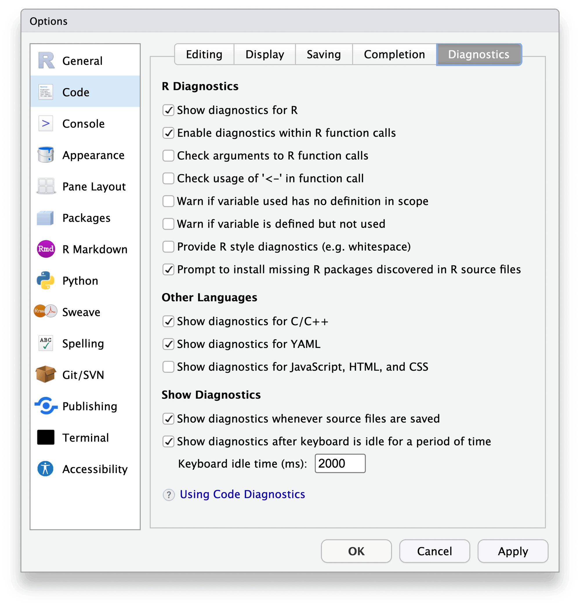
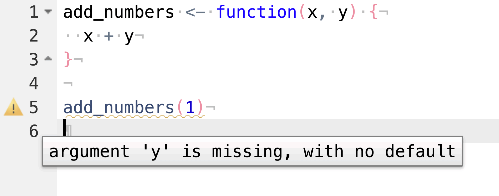
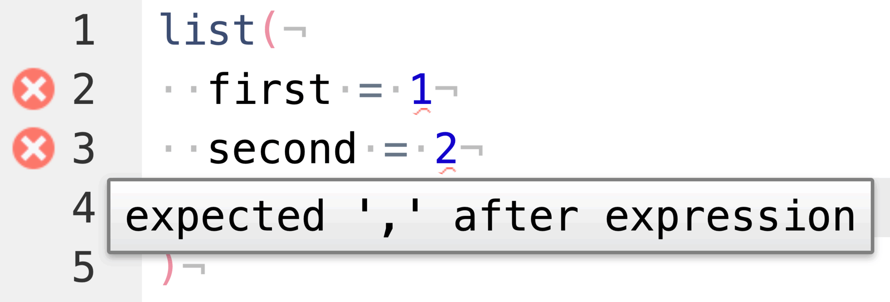
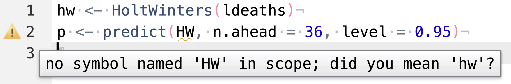
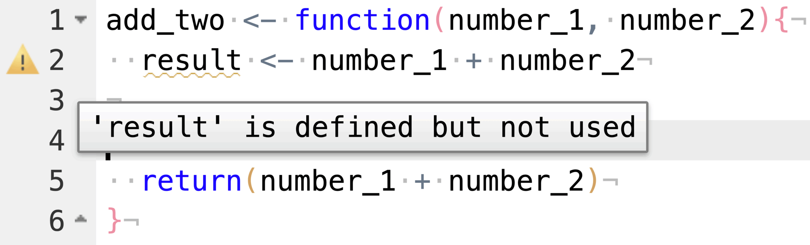
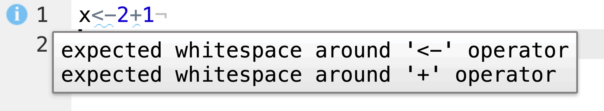
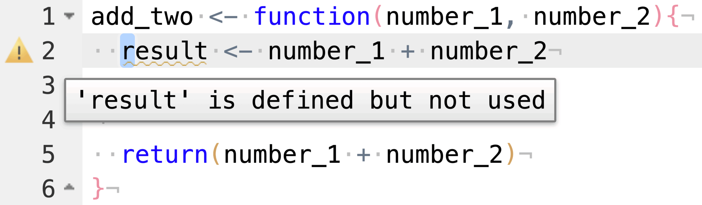
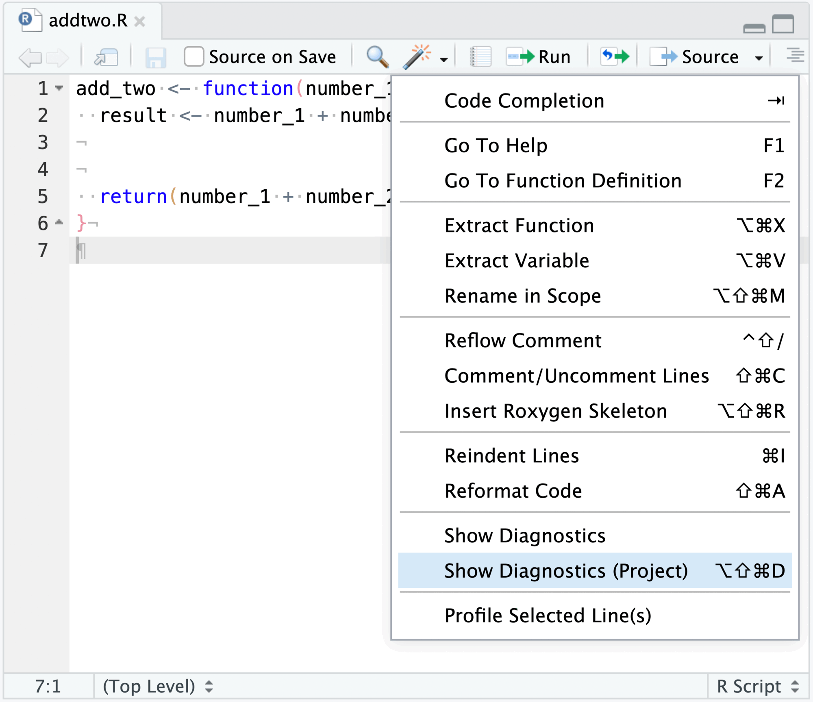
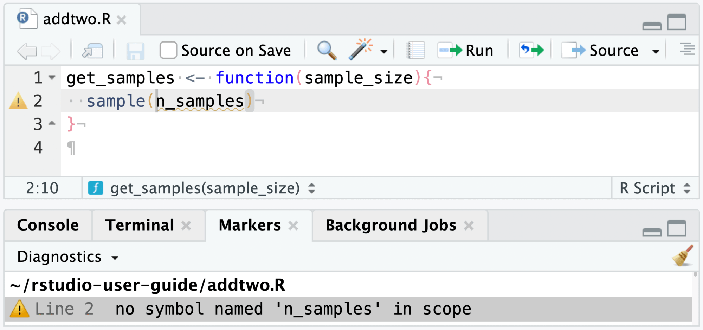
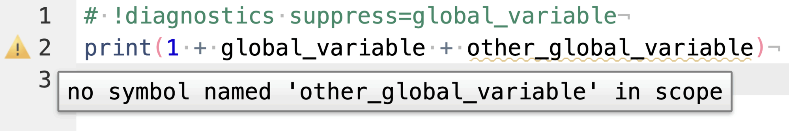

RStudio has the ability to perform static and dynamic analysis of R code or what is known as "Diagnostics". 
Diagnostics are a way to indicate stylistic issues or errors with the code.

## Enabling diagnostics

Diagnostics can be enabled and options can be set within the **Global Options** > **Code Diagnostics** editing pane:

{fig-alt="A screenshot of the RStudio Global Options popup, selected on the Code > Diagnostics tab."}

A brief outline of the options available:

### Show diagnostics for R

Toggle the display of R code diagnostics.

### Enable diagnostics within R function calls

Controls whether diagnostics are performed within function calls, e.g. `dplyr::select(mtcars, mpg, cyl)`. Toggle this if your code makes heavy use of non-standard evaluation, and RStudio is unable to produce correct diagnostics for you.

### Check arguments to R function calls

Try to detect whether a particular call to a function will succeed. The diagnostics engine will report if it detects missing arguments, unmatched arguments, partially matched arguments, and too many arguments.

For example, in the code sample below, RStudio detects that the function `add_numbers` is missing the `y` argument. It is not necessary for `add_numbers` to exist in the current environment (i.e., within the running R session).

{fig-alt="A screenshot of the RStudio error diagnostics suggesting that a function argument is missing."}

Similarly, missing arguments (alongside extra, or missing, commas) are reported:

{fig-alt="A screenshot of R code missing commas after each line, which returns an error 'exepcted , after expression'"}

### Warn if variable used has no definition in scope

Warn if a symbol is used with no definition in the current, or parent, scope. The diagnostics engine will supply a suggestion if there appears to be a typo in the symbol's name; that is, if a symbol with a similar name exists in scope as well.

{fig-alt="A screenshot of R code with a defined object not found, with a suggestion to use the correct object."}

### Warn if variable is defined but not used

This diagnostic helps to identify if a variable is created but never used. This can be helpful when attempting to clean up old code, or in diagnosing other errors (wherein you believe a particular variable should be used, but isn't).

In the following example, the variable `result` is assigned but never used or returned; instead, the sum is re-computed and then returned.

{fig-alt="A screenshot of a function where a defined object is not used, resulting a warning."}

### Provide R style diagnostics (e.g. whitespace)

The style diagnostic checks to see if your code conforms to [Hadley Wickham's style guide](http://adv-r.had.co.nz/Style.html), and reports style warnings when encountered. In particular, the diagnostics engine attempts to identify inappropriate use (or lack thereof) of whitespace.

{alt="" fig-alt="A screenshot of x<-2+1 without any spacing - RStudio provides a note for the style issue expecting whitespace"}

Currently, the style diagnostics feature is not user configurable; this may be addressed in an upcoming release.

## Other diagnostics

Diagnostics for other languages, such as C / C++, JavaScript, and Python, are also available.

### C / C++ diagnostics

The C / C++ diagnostics engine is powered by `libclang`, and is able to report compiler errors and warnings inline in the source document.

RStudio derives the compiler flags for a file from the way it would normally be built. For sources in an R package, the flags come from `R CMD SHLIB`, so the package's `src/Makevars` and `LinkingTo` dependencies are respected. For standalone files, they come from `Rcpp::sourceCpp()` or `cpp11::cpp_source()`. All errors in a file are reported; RStudio does not stop after clang's default error limit.

To add or override flags, create a `compile_flags.txt` file containing one argument per line, in the same format used by [clangd](https://clangd.llvm.org/design/compile-commands#compile_flagstxt). For a file inside the current project, RStudio looks for this file in the source file's directory and its parent directories, up to the project directory; for any other file, only the source file's own directory is checked. Its contents are appended to the generated flags, so they take precedence over the flags RStudio generates. Relative paths, such as `-Iinst/include`, are resolved against the directory containing `compile_flags.txt`. For example, to stop reporting after 50 errors and silence a warning:

```
-ferror-limit=50
-Wno-unused-parameter
```

Changes to `compile_flags.txt` take effect the next time diagnostics run; no restart is required. Problems with the flags themselves, such as an unknown argument, are reported as diagnostics on the first line of the source file.

In an R package, add `compile_flags.txt` to `.Rbuildignore` (for example, with `usethis::use_build_ignore("compile_flags.txt")`) so that `R CMD build` leaves it out of the package and `R CMD check` does not report it as a non-standard file.

To see the flags being passed to `libclang`, run `.rs.setClangDiagnostics(2)` in the R console, which restarts the R session, or set the `clang_verbose` preference to `2` in [`rstudio-prefs.json`](../productivity/custom-settings.qmd) and restart the R session yourself. The flags are then printed in the R console (RStudio shows the R session's standard error stream there) the next time a file is parsed from scratch, that is, when it is first opened or when its flags change; a reparse of an already indexed file does not print them again.

## Viewing diagnostics

When an error or warning is discovered, it is reported in two places:

1.  The left gutter will show an icon related to the diagnostic's severity

2.  The associated diagnostic will be underlined.

{fig-alt="A screenshot of R code displaying a yellow warning in the gutter, a popup for result is defined but not used, and a yellow underline bellow the defined but not used element."}

## Show diagnostics

These features allow you to control when diagnostics are presented and updated. Diagnostics can either be shown on save, or after a certain amount of keyboard idle time.

## Project-level diagnostics

You can run the diagnostics engine over all R files in the project either using the code wizard menu, or with the keyboard shortcut <kbd>Ctrl + Alt + Shift + D</kbd> (<kbd>Cmd + Alt + Shift + D</kbd> on Mac):

{fig-alt="A screenshot of the 'Code Tools' dropdown, displaying the ability to 'Show Diagnostics' for an entire project."}

After running diagnostics over the project (this may take some time), you will see the `Markers` pane populated with all discovered warnings and errors.

{fig-alt="A screenshot of the Markers for the addtwo.R file and other diagnostics across the project."}

## Magic comments

RStudio's diagnostics engine can be controlled on a per-file basis by adding magic comments to the document.

The following settings are currently supported:

`# !diagnostics off` \-- disable diagnostics within this document.

`# !diagnostics style=[true/false]` \-- toggle style diagnostics for this document.

`# !diagnostics level=[syntax/core/all]` \-- toggle the level, or severity, of diagnostics reported.

In addition, diagnostic warnings for particular variables can be suppressed with the suppress keyword:

`# !diagnostics suppress=<comma-separated list of variables>`

For example, in the below code snippet, the usage of `global_variable` is not reported, while the usage of `other_global_variable` is:

{fig-alt="A screenshot of a magic '!diagnostics suppress' comment that prevents a warning from being displayed in RStudio."}
