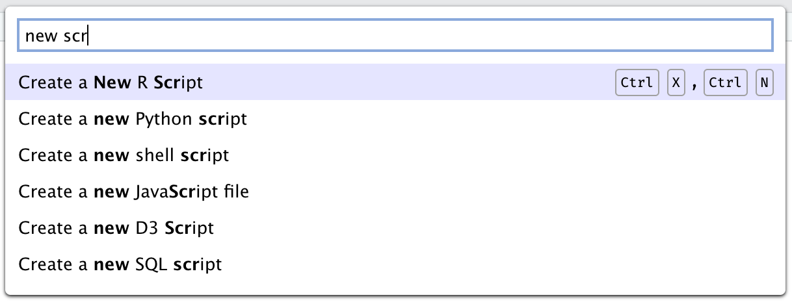

Some shortcuts may differ if non-default keybindings are selected (e.g., Emacs, Vim, or Sublime Text).

For a list that matches your platform, keybindings, and any shortcuts you have customized, use *Help* -\> *Keyboard Shortcuts Help*.

On Mac keyboards, Delete is the key that deletes backward (Backspace on Windows and Linux), and Forward Delete is Fn+Delete.

## Command Palette

A command palette is a software affordance that gives instant, searchable access to all of a program's commands. Command palettes have become a fixture of modern IDEs, and with good reason. They improve:

-   **Keyboard accessibility**; even commands that do not have keyboard shortcuts are easily invoked from the palette.

-   **Speed**; it is often much faster to invoke a command from the palette with a few quick keystrokes than to reach for the mouse or drill into a menu.

-   **Discoverability**; since the palette lists all the commands, it can be browsed to find a command for a task by name without trying to figure out which menu or toolbar might contain it.

All shortcuts can be accessed via the Command Palette:

| Description          | Windows & Linux                                       | Mac             |
|:---------------------|:------------------------------------------------------|:----------------|
| Show Command Palette | Ctrl+Shift+P (Ctrl+Alt+Shift+P in Firefox on Windows) | Shift+Command+P |

It's also available on the *Tools* menu (*Tools* -\> *Show Command Palette*).

## Accessibility

| Description                       | Windows & Linux        | Mac                      |
|:----------------------------------|:-----------------------|:-------------------------|
| Toggle Screen Reader Support      | Alt+Shift+/            | Ctrl+Shift+U             |
| Speak Text Editor Location        | Alt+Shift+1            | Ctrl+Option+1            |
| Focus Console Output              | Ctrl+\` or Alt+Shift+2 | Ctrl+\` or Ctrl+Option+2 |
| Toggle Tab Key Always Moves Focus | Alt+Shift+\[           | Ctrl+Option+\[           |
| Focus Next Pane                   | F6                     | F6                       |
| Focus Previous Pane               | Shift+F6               | Shift+F6                 |
| Focus Main Toolbar                | Alt+Shift+Y            | Ctrl+Option+Y            |

## Console

| Description                           | Windows & Linux | Mac           |
|:--------------------------------------|:----------------|:--------------|
| Move cursor to Console                | Ctrl+2          | Ctrl+2        |
| Clear console                         | Ctrl+L          | Ctrl+L        |
| Move cursor to beginning of line      | Home            | Command+Left  |
| Move cursor to end of line            | End             | Command+Right |
| Navigate command history              | Up/Down         | Up/Down       |
| Popup command history                 | Ctrl+Up         | Command+Up    |
| Interrupt currently executing command | Esc             | Esc           |
| Change working directory              | Ctrl+Shift+H    | Ctrl+Shift+H  |

## Source

| Description                                           | Windows & Linux                                     | Mac                                                          |
|:------------------------------------------------------|:----------------------------------------------------|:-------------------------------------------------------------|
| Go to File/Function                                   | Ctrl+. \[period\]                                   | Ctrl+. \[period\]                                            |
| Move cursor to Source Editor                          | Ctrl+1                                              | Ctrl+1                                                       |
| Toggle document outline                               | Ctrl+Shift+O                                        | Shift+Command+O                                              |
| Toggle visual markdown editor                         | Ctrl+Shift+F4                                       | Shift+Command+F4                                             |
| New R script                                          | Ctrl+Shift+N (Ctrl+Alt+Shift+N in Chrome on Server) | Shift+Command+N (Option+Shift+Command+N in Chrome on Server) |
| Open document                                         | Ctrl+O                                              | Command+O                                                    |
| Save active document                                  | Ctrl+S                                              | Command+S                                                    |
| Save all documents                                    | Ctrl+Alt+S                                          | Command+Option+S                                             |
| Close active document (except in Chrome on Server)    | Ctrl+W                                              | Command+W                                                    |
| Close all open documents (except in Chrome on Server) | Ctrl+Shift+W                                        | Shift+Command+W                                              |
| Close other documents                                 | Ctrl+Shift+Alt+W                                    | Option+Shift+Command+W                                       |
| Preview HTML (Markdown and HTML)                      | Ctrl+Shift+K                                        | Shift+Command+K                                              |
| Knit Document (knitr)                                 | Ctrl+Shift+K                                        | Shift+Command+K                                              |
| Render Document (Quarto)                              | Ctrl+Shift+K                                        | Shift+Command+K                                              |
| Compile Report (R script)                             | Ctrl+Shift+K                                        | Shift+Command+K                                              |
| Compile PDF (TeX and Sweave)                          | Ctrl+Shift+K                                        | Shift+Command+K                                              |
| Insert chunk (Sweave and Knitr)                       | Ctrl+Alt+I                                          | Option+Command+I                                             |
| Insert code section                                   | Ctrl+Shift+R                                        | Shift+Command+R or Ctrl+Shift+R                              |
| Run current line/selection                            | Ctrl+Enter                                          | Command+Return                                               |
| Run current line/selection (retain cursor position)   | Alt+Enter                                           | Option+Return                                                |
| Re-run previous region                                | Ctrl+Alt+P                                          | Option+Command+P                                             |
| Run current document                                  | Ctrl+Alt+R                                          | Option+Command+R                                             |
| Run from document beginning to current line           | Ctrl+Alt+B                                          | Option+Command+B                                             |
| Run from current line to document end                 | Ctrl+Alt+E                                          | Option+Command+E                                             |
| Run the current function definition                   | Ctrl+Alt+F                                          | Option+Command+F                                             |
| Run the current code section                          | Ctrl+Alt+T                                          | Option+Command+T                                             |
| Run previous Sweave/Rmd code                          | Ctrl+Alt+Shift+P                                    | Option+Shift+Command+P                                       |
| Run the current Sweave/Rmd chunk                      | Ctrl+Alt+C or Ctrl+Shift+Enter                      | Option+Command+C or Shift+Command+Return                     |
| Run the next Sweave/Rmd chunk                         | Ctrl+Alt+N                                          | Option+Command+N                                             |
| Source a file                                         | Ctrl+Alt+G                                          | Ctrl+Option+G                                                |
| Source the current document                           | Ctrl+Shift+S                                        | Shift+Command+S                                              |
| Source the current document (with echo)               | Ctrl+Shift+Enter                                    | Shift+Command+Return                                         |
| Send current line/selection to terminal               | Ctrl+Alt+Enter                                      | Option+Command+Return                                        |
| Fold Selected                                         | Alt+L                                               | Option+Command+L                                             |
| Unfold Selected                                       | Shift+Alt+L                                         | Option+Shift+Command+L                                       |
| Fold All                                              | Alt+O                                               | Option+Command+O                                             |
| Unfold All                                            | Shift+Alt+O                                         | Option+Shift+Command+O                                       |
| Go to line                                            | Shift+Alt+G                                         | Option+Shift+Command+G                                       |
| Jump to                                               | Shift+Alt+J                                         | Option+Shift+Command+J                                       |
| Expand selection                                      | Ctrl+Shift+Up                                       | Option+Shift+Command+Up                                      |
| Shrink selection                                      | Ctrl+Shift+Down                                     | Option+Shift+Command+Down                                    |
| Select current statement                              | Ctrl+Alt+Shift+S                                    | Ctrl+Option+Shift+S                                          |
| Next section                                          | Ctrl+PageDown                                       | Command+PageDown                                             |
| Previous section                                      | Ctrl+PageUp                                         | Command+PageUp                                               |
| Split into lines                                      | Ctrl+Alt+A                                          | Ctrl+Option+A                                                |
| Edit lines from start                                 | Ctrl+Alt+Shift+A                                    | Ctrl+Option+Shift+A                                          |
| Switch to tab                                         | Ctrl+Shift+. \[period\]                             | Ctrl+Shift+. \[period\]                                      |
| Previous tab                                          | Ctrl+F11, or Ctrl+Alt+Left (Windows)                | Ctrl+F11 or Ctrl+Option+Left                                 |
| Previous tab (desktop only)                           | Ctrl+Shift+Tab                                      | Ctrl+Shift+Tab                                               |
| Next tab                                              | Ctrl+F12, or Ctrl+Alt+Right (Windows)               | Ctrl+F12 or Ctrl+Option+Right                                |
| Next tab (desktop only)                               | Ctrl+Tab                                            | Ctrl+Tab                                                     |
| First tab                                             | Ctrl+Shift+F11 or Ctrl+Alt+Shift+Left               | Ctrl+Shift+F11 or Ctrl+Option+Shift+Left                     |
| Last tab                                              | Ctrl+Shift+F12 or Ctrl+Alt+Shift+Right              | Ctrl+Shift+F12 or Ctrl+Option+Shift+Right                    |
| Navigate back                                         | Ctrl+F9                                             | Command+F9                                                   |
| Navigate forward                                      | Ctrl+F10                                            | Command+F10                                                  |
| Extract function from selection                       | Ctrl+Alt+X                                          | Option+Command+X                                             |
| Extract variable from selection                       | Ctrl+Alt+V                                          | Option+Command+V                                             |
| Reindent lines                                        | Ctrl+I                                              | Command+I                                                    |
| Comment/uncomment current line/selection              | Ctrl+Shift+C                                        | Shift+Command+C                                              |
| Reflow Comment                                        | Ctrl+Shift+/                                        | Ctrl+Shift+/                                                 |
| Reformat Selection                                    | Ctrl+Shift+A                                        | Shift+Command+A                                              |
| Show Diagnostics for Current Project                  | Ctrl+Shift+Alt+D                                    | Option+Shift+Command+D                                       |
| Transpose Letters                                     | No shortcut                                         | Ctrl+T                                                       |
| Move Lines Up/Down                                    | Alt+Up/Down                                         | Option+Up or Down                                            |
| Copy Lines Up/Down                                    | Shift+Alt+Up/Down                                   | Option+Command+Up or Down                                    |
| Jump to Matching Brace/Paren                          | Ctrl+P                                              | Ctrl+P                                                       |
| Expand to Matching Brace/Paren                        | Ctrl+Shift+Alt+E                                    | Ctrl+Shift+E                                                 |
| Add Cursor Above Current Cursor                       | Ctrl+Alt+Up                                         | Ctrl+Option+Up                                               |
| Add Cursor Below Current Cursor                       | Ctrl+Alt+Down                                       | Ctrl+Option+Down                                             |
| Move Active Cursor Up                                 | Ctrl+Alt+Shift+Up                                   | Ctrl+Option+Shift+Up                                         |
| Move Active Cursor Down                               | Ctrl+Alt+Shift+Down                                 | Ctrl+Option+Shift+Down                                       |
| Find and Replace                                      | Ctrl+F                                              | Command+F                                                    |
| Find Next                                             | Win: F3, Linux: Ctrl+G                              | Command+G                                                    |
| Find Previous                                         | Win: Shift+F3, Linux: Ctrl+Shift+G                  | Shift+Command+G                                              |
| Use Selection for Find                                | Ctrl+F3                                             | Command+E                                                    |
| Replace and Find                                      | Ctrl+Shift+J                                        | Shift+Command+J                                              |
| Find in Files                                         | Ctrl+Shift+F                                        | Shift+Command+F                                              |
| Check Spelling                                        | F7                                                  | F7                                                           |
| Rename Symbol in Scope                                | Ctrl+Alt+Shift+M                                    | Option+Shift+Command+M                                       |
| Insert Roxygen Skeleton                               | Ctrl+Shift+Alt+R                                    | Option+Shift+Command+R                                       |

## Editing (Console and Source)

| Description                             | Windows & Linux            | Mac                                 |
|:----------------------------------------|:---------------------------|:------------------------------------|
| Undo                                    | Ctrl+Z                     | Command+Z                           |
| Redo                                    | Ctrl+Shift+Z               | Shift+Command+Z                     |
| Cut                                     | Ctrl+X                     | Command+X                           |
| Copy                                    | Ctrl+C                     | Command+C                           |
| Paste                                   | Ctrl+V                     | Command+V                           |
| Paste with Indent                       | Ctrl+Shift+V               | Command+Shift+V                     |
| Select All                              | Ctrl+A                     | Command+A                           |
| Jump to Word                            | Ctrl+Left/Right            | Option+Left or Right                |
| Jump to Start/End                       | Ctrl+Home/End              | Command+Up or Down                  |
| Delete Line                             | Ctrl+D                     | Command+D                           |
| Select                                  | Shift+\[Arrow\]            | Shift+\[Arrow\]                     |
| Select Word                             | Ctrl+Shift+Left/Right      | Option+Shift+Left or Right          |
| Select to Line Start                    | Alt+Shift+Left             | Shift+Command+Left                  |
| Select to Line End                      | Alt+Shift+Right            | Shift+Command+Right                 |
| Select Page Up/Down                     | Shift+PageUp/PageDown      | Shift+PageUp or PageDown            |
| Select to Start/End                     | Ctrl+Shift+Home/End        | Shift+Command+Up or Down            |
| Delete Word Left                        | Ctrl+Backspace             | Option+Delete or Ctrl+Option+Delete |
| Delete Word Right                       | Ctrl+Delete                | Option+Forward Delete               |
| Delete to Line End                      | Alt+Delete                 | Ctrl+K                              |
| Delete to Line Start                    | Alt+Backspace              | Command+Delete                      |
| Indent                                  | Tab (at beginning of line) | Tab (at beginning of line)          |
| Outdent                                 | Shift+Tab                  | Shift+Tab                           |
| Yank line up to cursor                  | Ctrl+U                     | Ctrl+U                              |
| Yank line after cursor                  | Ctrl+K                     | Ctrl+K                              |
| Insert currently yanked text            | Ctrl+Y                     | Ctrl+Y                              |
| Insert assignment operator              | Alt+-                      | Option+-                            |
| Insert pipe operator                    | Ctrl+Shift+M               | Shift+Command+M                     |
| Show help for function at cursor        | F1                         | F1                                  |
| Show source code for function at cursor | F2                         | F2                                  |
| Find usages for symbol at cursor (C++)  | Ctrl+Alt+U                 | Option+Command+U                    |

## Completions (Console and Source)

| Description               | Windows & Linux   | Mac               |
|:--------------------------|:------------------|:------------------|
| Attempt completion        | Tab or Ctrl+Space | Tab or Ctrl+Space |
| Navigate candidates       | Up/Down           | Up or Down        |
| Accept selected candidate | Enter or Tab      | Return or Tab     |
| Dismiss completion popup  | Esc               | Esc               |

## Posit Assistant

| Description                  | Windows & Linux | Mac             |
|:-----------------------------|:----------------|:----------------|
| Show Posit Assistant         | Ctrl+Shift+I    | Ctrl+Command+I  |
| Request code suggestions     | Ctrl+\\         | Command+\\      |
| Accept next edit suggestion  | Ctrl+;          | Command+;       |
| Dismiss next edit suggestion | Ctrl+Shift+;    | Shift+Command+; |

## Views

| Description                       | Windows & Linux                                    | Mac                                                                                |
|:----------------------------------|:---------------------------------------------------|:-----------------------------------------------------------------------------------|
| Move focus to Source Editor       | Ctrl+1                                             | Ctrl+1                                                                             |
| Zoom Source Editor                | Ctrl+Shift+1                                       | Ctrl+Shift+1                                                                       |
| Move focus to Console             | Ctrl+2                                             | Ctrl+2                                                                             |
| Zoom Console                      | Ctrl+Shift+2                                       | Ctrl+Shift+2                                                                       |
| Move focus to Help                | Ctrl+3                                             | Ctrl+3                                                                             |
| Zoom Help                         | Ctrl+Shift+3                                       | Ctrl+Shift+3                                                                       |
| Move Focus to Terminal            | Alt+Shift+M                                        | Option+Shift+M                                                                     |
| Show History                      | Ctrl+4                                             | Ctrl+4                                                                             |
| Zoom History                      | Ctrl+Shift+4                                       | Ctrl+Shift+4                                                                       |
| Show Files                        | Ctrl+5                                             | Ctrl+5                                                                             |
| Zoom Files                        | Ctrl+Shift+5                                       | Ctrl+Shift+5                                                                       |
| Show Plots                        | Ctrl+6                                             | Ctrl+6                                                                             |
| Zoom Plots                        | Ctrl+Shift+6                                       | Ctrl+Shift+6                                                                       |
| Show Packages                     | Ctrl+7                                             | Ctrl+7                                                                             |
| Zoom Packages                     | Ctrl+Shift+7                                       | Ctrl+Shift+7                                                                       |
| Show Environment                  | Ctrl+8                                             | Ctrl+8                                                                             |
| Zoom Environment                  | Ctrl+Shift+8                                       | Ctrl+Shift+8                                                                       |
| Show Viewer                       | Ctrl+9                                             | Ctrl+9                                                                             |
| Zoom Viewer                       | Ctrl+Shift+9                                       | Ctrl+Shift+9                                                                       |
| Show Git/SVN                      | Ctrl+F1                                            | Command+F1                                                                         |
| Zoom Git/SVN                      | Ctrl+Shift+F1                                      | Ctrl+Shift+F1                                                                      |
| Show Build                        | Ctrl+F2                                            | Command+F2                                                                         |
| Zoom Build                        | Ctrl+Shift+F2                                      | Ctrl+Shift+F2                                                                      |
| Show Connections                  | Ctrl+F5                                            | No shortcut                                                                        |
| Zoom Connections                  | Ctrl+Shift+F5                                      | Ctrl+Shift+F5                                                                      |
| Zoom Tutorial                     | Ctrl+Shift+F6                                      | Ctrl+Shift+F6                                                                      |
| Show Find in Files Results        | Ctrl+F6                                            | Command+F6                                                                         |
| Show Presentation                 | Ctrl+F8                                            | Command+F8                                                                         |
| Zoom Presentation                 | Ctrl+Shift+F7                                      | Ctrl+Shift+F7                                                                      |
| Zoom left column                  | Ctrl+Alt+Shift+F12                                 | Ctrl+Option+Shift+F12                                                              |
| Zoom right column                 | Ctrl+Alt+Shift+F11                                 | Ctrl+Option+Shift+F11                                                              |
| Zoom sidebar                      | Ctrl+Alt+Shift+F10                                 | Ctrl+Option+Shift+F10                                                              |
| Show all panes                    | Ctrl+Shift+0 (Ctrl+Alt+Shift+0 on Windows desktop) | Ctrl+Shift+0                                                                       |
| Add source column                 | Ctrl+F7                                            | Command+F7                                                                         |
| Zoom in (desktop only)            | Ctrl+=                                             | Command+=                                                                          |
| Zoom out (desktop only)           | Ctrl+-                                             | Command+-                                                                          |
| Actual size (desktop only)        | Ctrl+0                                             | Command+0                                                                          |
| Toggle full screen (desktop only) | F11                                                | Ctrl+Command+F                                                                     |
| Global Options                    | No shortcut                                        | Command+, \[comma\] (Chrome, Desktop) Option+Command+, \[comma\] (Safari, Firefox) |
| Project Options                   | No shortcut                                        | Shift+Command+, \[comma\]                                                          |

## Help

| Description                      | Windows & Linux                                       | Mac             |
|:---------------------------------|:------------------------------------------------------|:----------------|
| Show Command Palette             | Ctrl+Shift+P (Ctrl+Alt+Shift+P in Firefox on Windows) | Shift+Command+P |
| Show Keyboard Shortcut Reference | Alt+Shift+K                                           | Option+Shift+K  |
| Search R Help                    | Ctrl+Alt+F1                                           | Ctrl+Option+F1  |
| Find in Help Topic               | Ctrl+F                                                | Command+F       |
| Previous Help Topic              | Shift+Alt+F2                                          | Option+Shift+F2 |
| Next Help Topic                  | Shift+Alt+F3                                          | Option+Shift+F3 |

## Build

| Description            | Windows & Linux | Mac               |
|:-----------------------|:----------------|:------------------|
| Install Package        | Ctrl+Shift+B    | Shift+Command+B   |
| Load All (devtools)    | Ctrl+Shift+L    | Shift+Command+L   |
| Test Package (Desktop) | Ctrl+Shift+T    | Shift+Command+T   |
| Test Package (Web)     | Ctrl+Alt+F7     | Option+Command+F7 |
| Check Package          | Ctrl+Shift+E    | Shift+Command+E   |
| Document Package       | Ctrl+Shift+D    | Shift+Command+D   |

## Debug

| Description          | Windows & Linux | Mac      |
|:---------------------|:----------------|:---------|
| Toggle Breakpoint    | Shift+F9        | Shift+F9 |
| Execute Next Line    | F10             | F10      |
| Step Into Function   | Shift+F4        | Shift+F4 |
| Finish Function/Loop | Shift+F7        | Shift+F7 |
| Continue             | Shift+F5        | Shift+F5 |
| Stop Debugging       | Shift+F8        | Shift+F8 |

## Plots

| Description   | Windows & Linux                     | Mac                                          |
|:--------------|:------------------------------------|:---------------------------------------------|
| Previous plot | Ctrl+Alt+F11 or Ctrl+Shift+PageUp   | Option+Command+F11 or Shift+Command+PageUp   |
| Next plot     | Ctrl+Alt+F12 or Ctrl+Shift+PageDown | Option+Command+F12 or Shift+Command+PageDown |

## Git/SVN

| Description                              | Windows & Linux   | Mac                     |
|:-----------------------------------------|:------------------|:------------------------|
| Diff active source document              | Ctrl+Alt+D        | Ctrl+Option+D           |
| Commit changes                           | Ctrl+Alt+M        | Ctrl+Option+M           |
| Go to next change in source document     | Ctrl+Alt+PageDown | Option+Command+PageDown |
| Go to previous change in source document | Ctrl+Alt+PageUp   | Option+Command+PageUp   |
| Scroll diff view                         | Ctrl+Up/Down      | Ctrl+Up or Down         |
| Stage/Unstage (Git)                      | Spacebar          | Spacebar                |
| Stage/Unstage and move to next (Git)     | Enter             | Return                  |

## Session

| Description                 | Windows & Linux | Mac             |
|:----------------------------|:----------------|:----------------|
| Quit Session (desktop only) | Ctrl+Q          | Command+Q       |
| Restart R Session           | Ctrl+Shift+F10  | Shift+Command+0 |

## Terminal

| Description            | Windows & Linux | Mac              |
|:-----------------------|:----------------|:-----------------|
| New Terminal           | Shift+Alt+R     | Option+Shift+R   |
| Move Focus to Terminal | Shift+Alt+M     | Option+Shift+M   |
| Previous Terminal      | Shift+Alt+F11   | Option+Shift+F11 |
| Next Terminal          | Shift+Alt+F12   | Option+Shift+F12 |

## Main Menu (Server)

| Description  | Windows & Linux | Mac           |
|:-------------|:----------------|:--------------|
| File Menu    | Alt+Shift+F     | Ctrl+Option+F |
| Edit Menu    | Alt+Shift+E     | Ctrl+Option+I |
| Code Menu    | Alt+Shift+C     | Ctrl+Option+C |
| View Menu    | Alt+Shift+V     | Ctrl+Option+V |
| Plots Menu   | Alt+Shift+P     | Ctrl+Option+P |
| Session Menu | Alt+Shift+S     | Ctrl+Option+S |
| Build Menu   | Alt+Shift+B     | Ctrl+Option+B |
| Debug Menu   | Alt+Shift+U     | Ctrl+Option+U |
| Profile Menu | Alt+Shift+I     | Ctrl+Option+O |
| Tools Menu   | Alt+Shift+T     | Ctrl+Option+T |
| Help Menu    | Alt+Shift+H     | Ctrl+Option+H |
